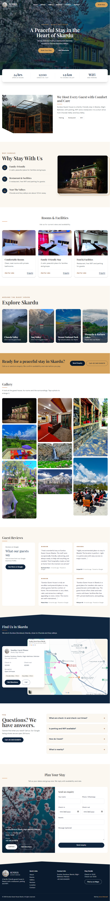

# Sundus Guest House Skardu

A responsive website for **Sundus Guest House**, a family-friendly guest house in Sundus (Sondous), Skardu, Gilgit-Baltistan, Pakistan. Guests can see the rooms and facilities, browse photos, read Google reviews, find the location and contact the guest house.

[](https://naxt-js-guest-house.vercel.app/) [](https://github.com/asmashahzadi764-alt/Naxt.js-Guest-house) [](https://www.linkedin.com/in/asma-shahzadi/)

## Preview

### Laptop


### Tablet


### Mobile


## Features

- Landing page with hero, quick facts, about, rooms and facilities, nearby places, photo gallery, guest reviews, map, FAQ and contact form
- Photo gallery with a full-screen viewer (keyboard and swipe-friendly buttons)
- Google Maps embed with a directions link
- Guest reviews from the Google Business Profile, with a link to see more on Google
- Contact form with validation and clear error messages
- Business data served through API routes instead of being hardcoded in the pages
- Structured data (JSON-LD, `LodgingBusiness`), page metadata, `sitemap.xml` and `robots.txt`
- Fully responsive layout for mobile, tablet and desktop

## Tech Stack

       

Fonts: Playfair Display and DM Sans via `next/font`. Framework: Next.js 14 with the App Router.

## Project Structure

```
app/
  api/
    contact/route.ts     POST: receives enquiries
    reviews/route.ts     GET: rating summary and reviews
    rooms/route.ts       GET: rooms and facilities
    timings/route.ts     GET: check-in, check-out and reception hours
  layout.tsx             fonts and site metadata
  page.tsx               landing page and structured data
  robots.ts
  sitemap.ts
components/
  Amp.tsx                renders "&" in the body font
  Dynamic.tsx            rooms, reviews, timings, gallery and contact form
data/
  business.json          all business information
docs/screenshots/        README images
public/
  images/                logo and site photos
```

## API Endpoints

| Method | Route | Description |
|---|---|---|
| GET | `/api/rooms` | Rooms and facilities |
| GET | `/api/reviews` | Rating summary, review list and Google link |
| GET | `/api/timings` | Check-in, check-out and reception hours |
| POST | `/api/contact` | Submit an enquiry (`name`, `phone`, `checkIn`, `checkOut`, `guests`, `message`) |

## Getting Started

Requirements: Node.js 18 or newer.

```bash
git clone https://github.com/asmashahzadi764-alt/Next.js-Guest-house.git
cd Next.js-Guest-house
npm install
npm run dev
```

Open http://localhost:3000.

Production build:

```bash
npm run build
npm start
```

### Environment variables

| Variable | Description |
|---|---|
| `NEXT_PUBLIC_SITE_URL` | Public URL of the site, used for metadata, the sitemap and `robots.txt` |

Example `.env.local`:

```
NEXT_PUBLIC_SITE_URL=https://naxt-js-guest-house.vercel.app
```

## Updating Content

**Business details.** Edit `data/business.json`: address, phone, coordinates, check-in and check-out times, amenities, nearby places, rooms and reviews. The pages and API routes read from this file.

**Reviews.** Add real reviews to the `reviews` list (`author`, `rating`, `text`, `date`). Set `rating` and `reviewCount` once they are confirmed on Google Maps.

**Photos.** Put images in `public/images/`:

| File | Used for |
|---|---|
| `logo.png` | Header, footer and map card |
| `hero.jpg` | Hero background |
| `about.jpg` | About section |
| `gallery-1.jpg` to `gallery-8.jpg` | Photo gallery |
| `room-1.jpg` to `room-3.jpg` | Rooms and facilities cards |
| `place-1.jpg` to `place-4.jpg` | Explore Skardu cards |
| `contact.jpg` | Contact section |

**README screenshots.** Save them in `docs/screenshots/` as `laptop.png`, `tablet.png` and `mobile.png`.

## Notes

- Enquiries sent through the contact form are currently written to the server log. Connect `app/api/contact/route.ts` to an email or messaging service to receive them directly.
- Structured data can be checked with Google's Rich Results Test.

## Deployment

The project is deployed on Vercel. Every push to `main` triggers a new deployment. Set `NEXT_PUBLIC_SITE_URL` in the Vercel project settings.

## Author

Built by **Asma Shahzadi**.

[](https://www.linkedin.com/in/asma-shahzadi/)